# Slides

**A visual-first skill for making browser-ready presentations.**

Slides helps a coding agent turn a brief, rough notes, or an existing PowerPoint
into a designed HTML deck. Pick a visual direction by comparing real slide
previews—not by choosing from a list of abstract adjectives.

> Repository: [Slides](https://github.com/zakiuhh/slides) ·
> Claude Chat: paste the prompt below · Claude Code: point it to this repo
>
> No separate installation is needed for these workflows.

## Contents

- [What you can make](#what-you-can-make)
- [How to use it](#how-to-use-it)
- [The workflow](#the-workflow)
- [Choose a visual language](#choose-a-visual-language)
- [Theme screenshot gallery](#theme-screenshot-gallery)
- [Fixed-stage design](#fixed-stage-design-readable-everywhere)
- [Review and share](#review-and-share)
- [Maintain the skill package](#maintain-the-skill-package)
- [Project map](#project-map)
- [License](#license)

## What you can make

- **A new deck** from a topic, outline, meeting notes, research, or a draft script
- **A talk or keynote** paced for a live speaker, with concise copy and strong visual beats
- **A reading deck** with more context, comparisons, tables, and explanatory detail
- **A web version of a PowerPoint** that preserves extracted text, images, and speaker notes for the redesign process
- **An improvement pass** on an existing HTML presentation, including layout and overflow fixes
- **A shareable deliverable** as a browser-ready HTML file, PDF, or reviewed screenshot set

The generated deck is a single HTML file with inline CSS and JavaScript. It runs
in a browser without a framework or build step, and its slide stage scales as a
whole instead of reflowing the layout on smaller screens.

## The workflow

1. **Set the brief.** Clarify the audience, purpose, length, and whether slides
   are meant for a live talk or for reading later.
2. **Shape the story.** Organize the source content and decide what belongs on
   each slide. Supplied images can guide the outline rather than being added as
   an afterthought.
3. **Compare three directions.** Generate three title-slide previews with
   deliberately different visual systems. Choose one or mix specific elements.
4. **Build the deck.** Carry the selected system across opening, section,
   content, data, quote, and closing slides.
5. **Review the render.** Inspect the screenshots for clipping, overlap, weak
   hierarchy, and browser errors; fix issues before delivery.
6. **Share it.** Open the HTML locally, export a PDF, or deploy the deck.

### Try a request

```text
Use Slides to make a 10-slide product launch deck for a live audience.
The audience is design-conscious founders. Keep the copy concise and show me
three distinct visual directions before building the full deck.
```

Other useful starts:

```text
Turn these notes into a reading-first strategy presentation.
Convert this PowerPoint to an editable web presentation.
Review this HTML deck for overflow and visual consistency, then improve it.
```

## How to use it

Choose the tool you are already using, copy its prompt below, replace the
bracketed details, and send it. The skill will guide content discovery and
style previews; you choose a direction before the full deck is generated.

### Claude Chat — copy, paste, customize

Replace the bracketed details and send this as a chat message:

```text
Use the Slides skill and workflow from this repository:
https://github.com/zakiuhh/slides

Create a presentation about [TOPIC] for [AUDIENCE]. Its purpose is [PURPOSE],
and it should be about [NUMBER] slides. This is a [LIVE TALK / READING DECK].

Follow the skill's content discovery and visual style process. Show me three
clearly different single-slide previews first, then wait for me to choose a
direction before making the full deck. Deliver a browser-ready HTML file. If
you cannot open the repository from this chat, tell me and ask me to attach
SKILL.md and the supporting files rather than guessing what they say.
```

### Claude Code — use the repository instructions

Paste this into Claude Code and replace the bracketed details:

```text
Use the Slides skill from https://github.com/zakiuhh/slides. Read SKILL.md and
load the supporting files it references when needed. If you cannot access the
repository directly, ask me for the relevant files.

Create a presentation about [TOPIC] for [AUDIENCE], for [PURPOSE], with about
[NUMBER] slides. This is a [LIVE TALK / READING DECK]. Ask me the skill's
content-discovery questions, show me three distinct style previews, and wait
for me to choose before building the full deck. Save the finished HTML and its
assets in ./slides-output/.
```

Other coding agents can follow the same link-first approach: give them the
repository URL and ask them to read [`SKILL.md`](SKILL.md) before creating the
deck.

## Choose a visual language

There are **24 curated visual presets** in [`STYLE_PRESETS.md`](STYLE_PRESETS.md), plus
**34 optional bold design systems** in [`bold-template-pack/`](bold-template-pack/).
The skill normally shows only three previews at a time so the choice stays
visual and manageable.

A few starting points:

| If you want… | Try… |
| --- | --- |
| Calm editorial structure | Coastal Ledger, Paper & Ink, or Notebook Tabs |
| Precise, technical storytelling | Arctic Signal, Swiss Modern, or Blueprint Lab |
| Distinctive, warm character | Ember Archive, Terracotta Atelier, or Mineral Study |
| A more expressive direction | Creative Voltage, Plum Observatory, or Analog Future |

The themes are design systems, not color swaps: each should have a distinct
composition and information hierarchy. Motifs should help communicate or
organize the content—not decorate every slide by default.

## Theme screenshot gallery

A few screenshots from the optional Bold Template Pack show how different
systems handle cover, content, and later slides. The images are stored locally
in [`assets/theme-screenshots/`](assets/theme-screenshots/), so the gallery
still works without loading image files from another site. Each template title
links to its original design source.

### [Soft Editorial](https://github.com/zarazhangrui/beautiful-html-templates/tree/main/templates/soft-editorial/)

<p>
  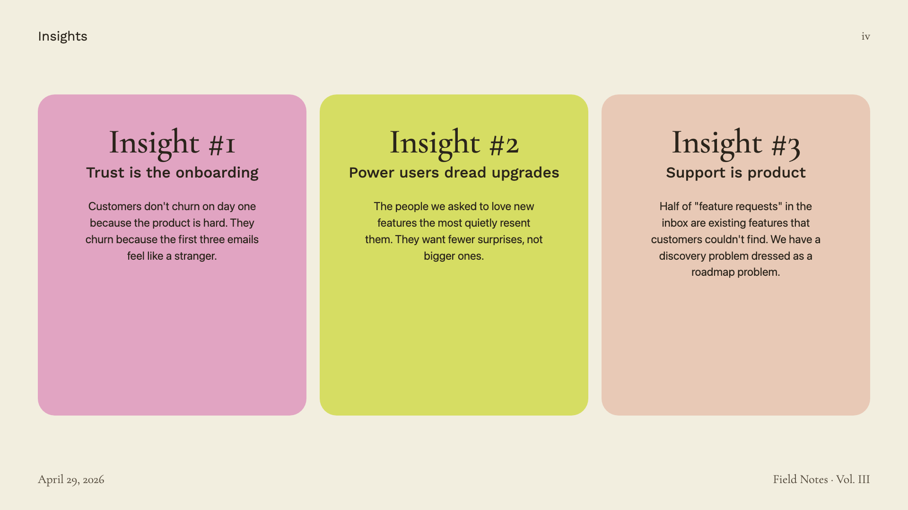
  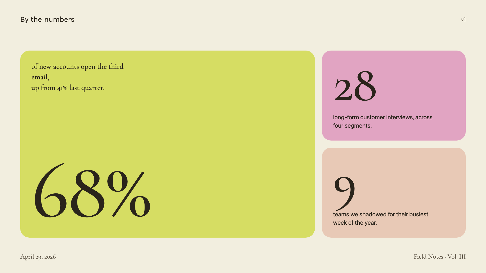
  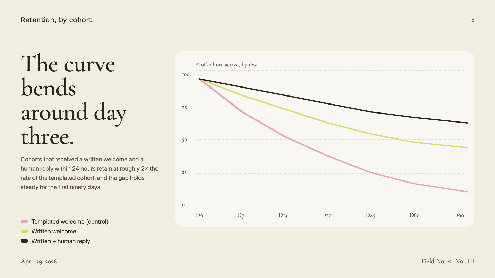
</p>

> Warm paper, expressive Cormorant Garamond, and gentle color accents.

### [Cobalt Grid](https://github.com/zarazhangrui/beautiful-html-templates/tree/main/templates/cobalt-grid/)

<p>
  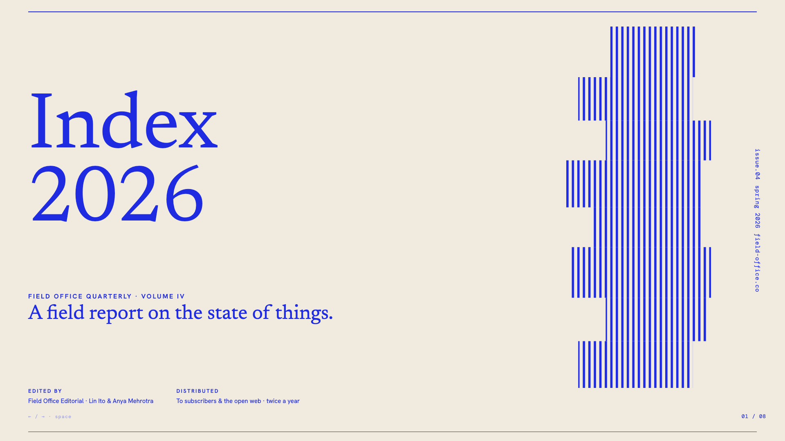
  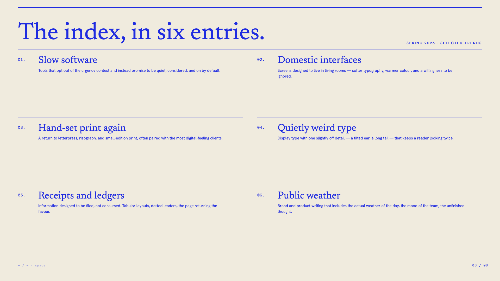
  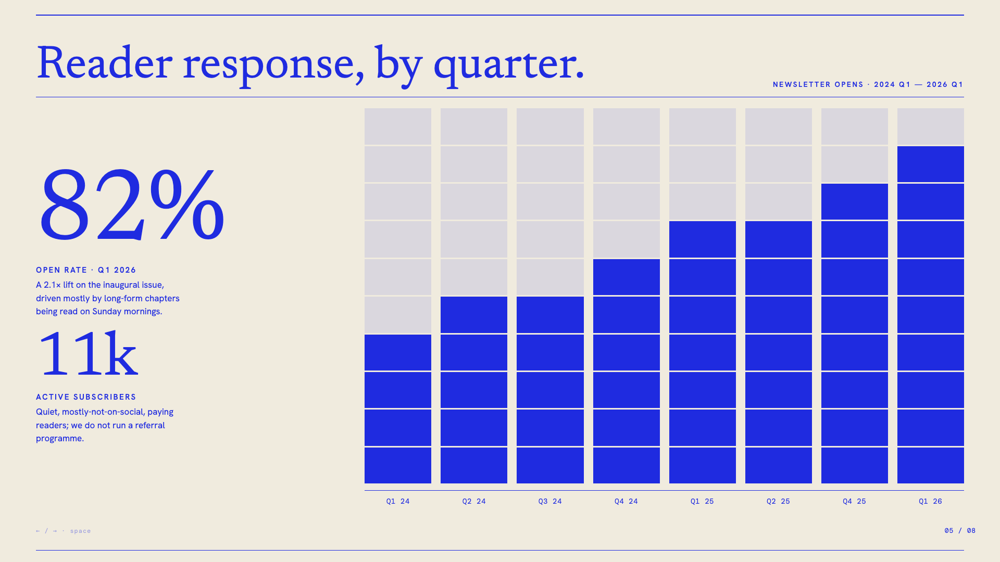
</p>

> Electric cobalt, editorial type, and a graph-paper grid.

### [Vellum](https://github.com/zarazhangrui/beautiful-html-templates/tree/main/templates/vellum/)

<p>
  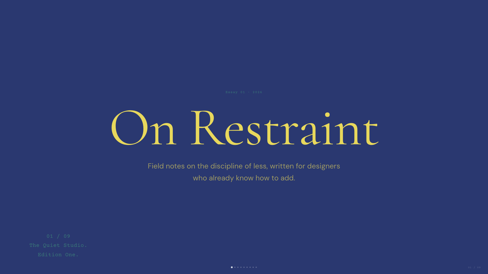
  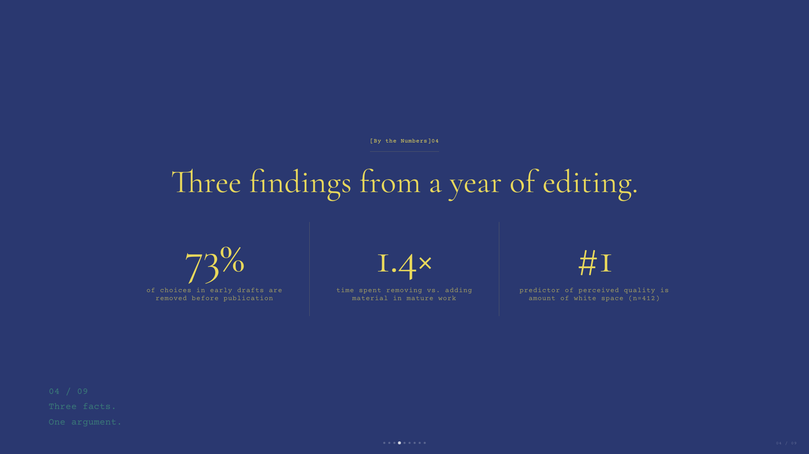
  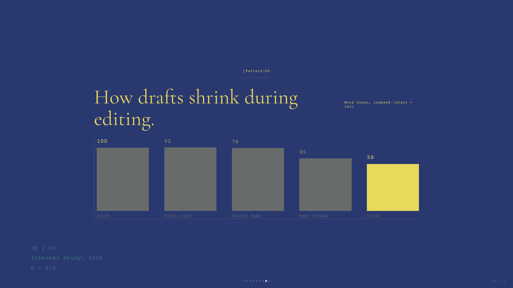
</p>

> Deep navy, warm yellow, and restrained serif typography.

### [Blue Professional](https://github.com/zarazhangrui/beautiful-html-templates/tree/main/templates/blue-professional/)

<p>
  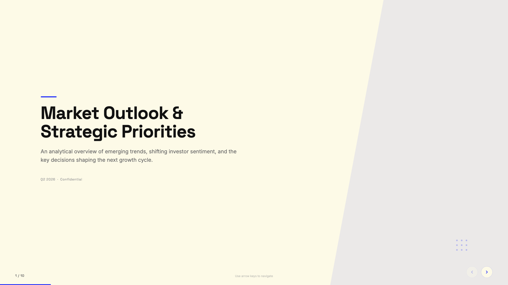
  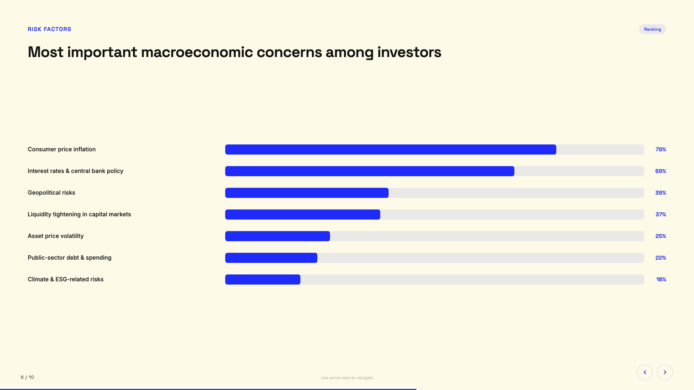
  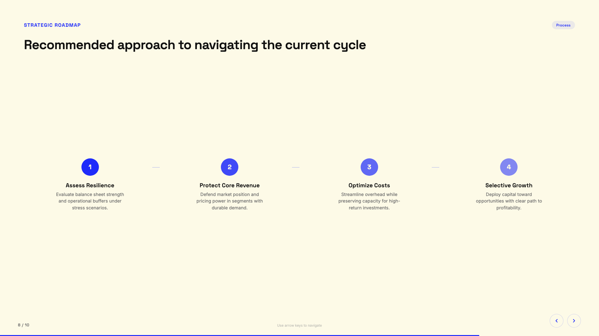
</p>

> A restrained professional layout with paper tones and electric cobalt accents.

### [Emerald Editorial](https://github.com/zarazhangrui/beautiful-html-templates/tree/main/templates/emerald-editorial/)

<p>
  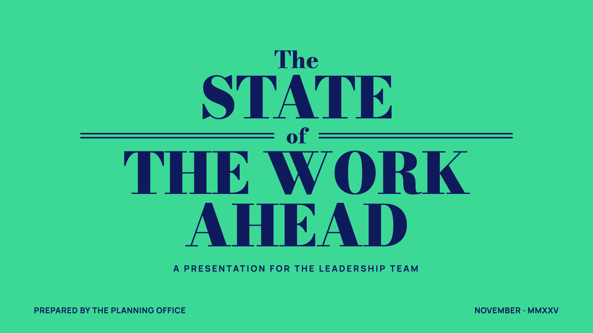
  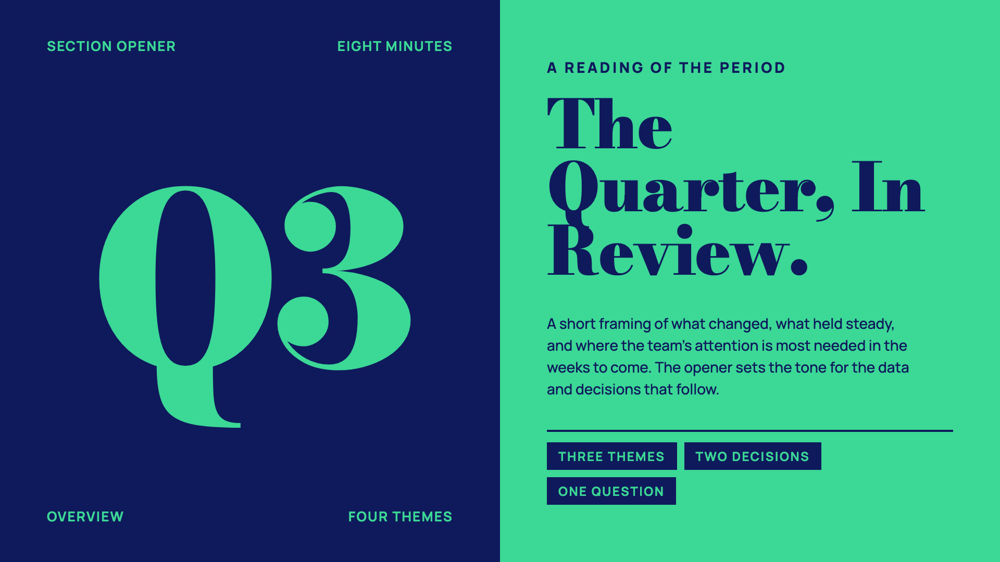
  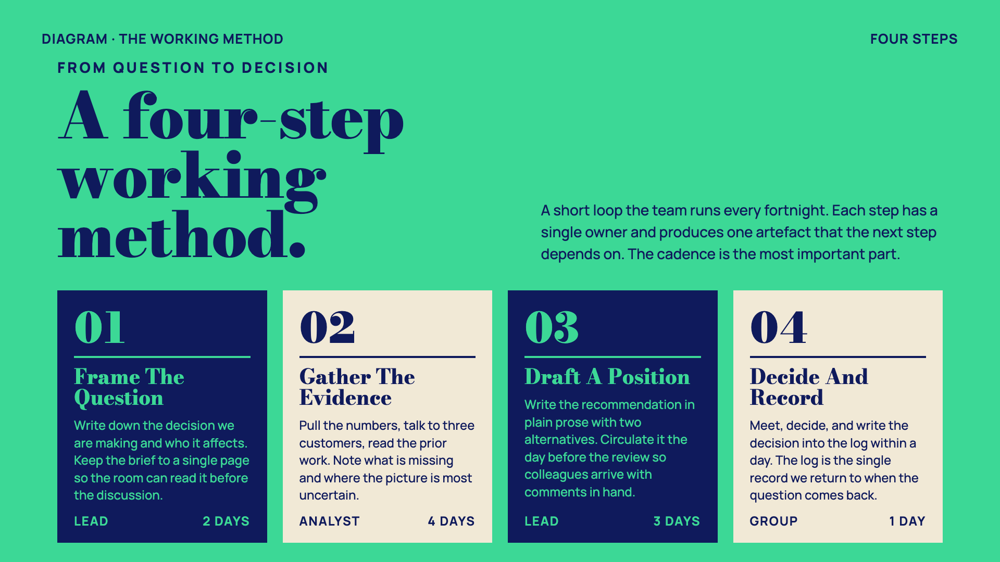
</p>

> Magazine-inspired emerald, navy, and paper with a strong display serif.

### [Retro Windows](https://github.com/zarazhangrui/beautiful-html-templates/tree/main/templates/retro-windows/)

<p>
  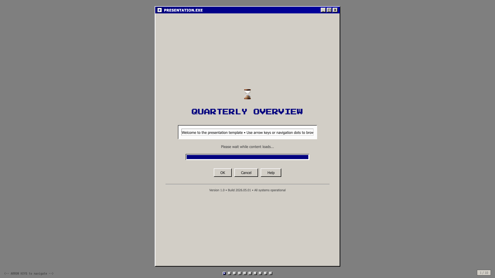
  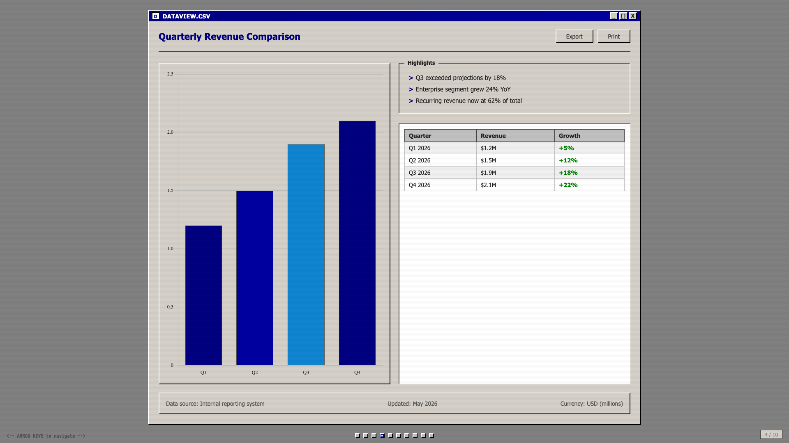
  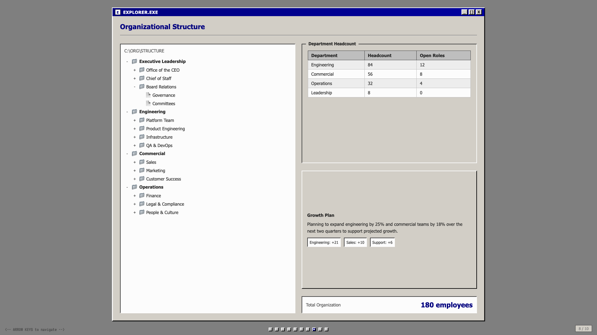
</p>

> A playful throwback to classic desktop windows and pixel-era interface chrome.

These preview images are from the MIT-licensed
[`beautiful-html-templates`](https://github.com/zarazhangrui/beautiful-html-templates)
project. Their attribution and license are included alongside the downloaded
assets.

## Fixed-stage design, readable everywhere

Slides are authored on a **1920×1080 canvas** and scale as a whole to fit the
browser. The stage stays 16:9 on phones and tablets; it letterboxes rather than
reflowing the slide content. The skill also calls for reduced-motion support,
keyboard navigation, and layouts that fit the selected speaking or reading
density.

Generated presentations have no runtime dependencies. Optional build-time
utilities are separate:

- PowerPoint extraction uses Python and `python-pptx`.
- PDF export uses Playwright and Chromium.
- Live deployment uses the Vercel CLI and a Vercel account.

## Review and share

### Preview QA

For an automated screenshot set, install the optional local browser tooling once
from the repository root:

```bash
npm install --no-save --no-package-lock playwright
npx playwright install chromium
node scripts/preview-qa.mjs ./my-deck/
```

The command captures every slide at 1920×1080, plus representative 1280×720
and phone-size views. It writes a contact sheet and `qa-report.json` under
`.frontend-slides-qa/`. Inspect the contact sheet yourself: automated checks
can spot likely overflow and browser failures, but they cannot judge whether a
deck feels clear, coherent, and right for its audience.

### Export a PDF

```bash
bash scripts/export-pdf.sh ./my-deck/index.html
```

PDFs are static snapshots; animations are not preserved. For a smaller file,
add `--compact` to render at 1280×720.

### Deploy a live deck

```bash
bash scripts/deploy.sh ./my-deck/
```

The deploy helper prepares the deck and guides you through Vercel login when
needed. Review the deck and remove any QA artifacts before sharing.

## Maintain the skill package

The repository root is the source of truth; the packaged Claude Code skill
copy receives synchronized skill assets, scripts, and the bold-template pack.

```bash
py scripts/sync-plugin-package.py
py scripts/validate-repo.py
```

`validate-repo.py` checks the preset count, template-index JSON, indexed
template paths, and parity between the source files and packaged skill copy.
On macOS/Linux, use `python3` (or `python`) instead of `py`.

## Project map

| Path | Why it exists |
| --- | --- |
| `SKILL.md` | Workflow, design rules, and fixed-stage requirements |
| `STYLE_PRESETS.md` | 24 curated style directions |
| `bold-template-pack/` | 34 optional, deeply specified design systems |
| `html-template.md` | Presentation markup, navigation, and editing patterns |
| `viewport-base.css` | Required fixed-stage CSS |
| `animation-patterns.md` | Motion patterns and guidance |
| `assets/theme-screenshots/` | Local preview images used in this README |
| `scripts/` | PPTX extraction, PDF export, deployment, QA, and maintenance tools |
| `plugins/frontend-slides/` | Packaged Claude Code skill assets |

## License

MIT. See [`LICENSE`](LICENSE).
